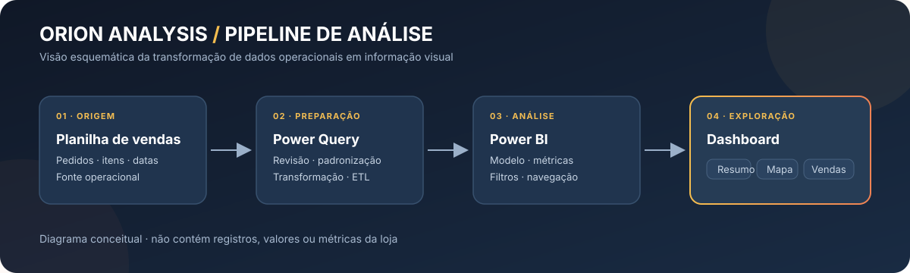
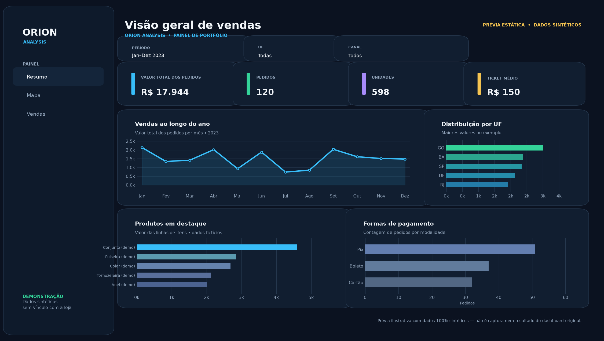

# Orion Analysis — Análise de Vendas e Dashboard

> Projeto acadêmico de análise de dados: transformar uma exportação de vendas despadronizada em tabelas consistentes e, depois, em uma dashboard interativa no Power BI.

## Visão geral

A Orion Analysis é uma empresa fictícia criada por um grupo de estudantes para apresentar uma solução de Business Intelligence a uma loja varejista real. Segundo a equipe, a fonte recebida estava desorganizada e com formatos inconsistentes. O grupo tratou os dados para estabelecer um padrão único e, só depois dessa preparação, carregou a versão tratada no Power BI para construir as dashboards.

O objetivo do painel era tornar perguntas de negócio mais acessíveis: como as vendas evoluem ao longo do tempo, quais produtos se destacam e como os resultados se distribuem por região e canal. É uma entrega acadêmica e uma demonstração de portfólio — não um sistema de produção nem uma auditoria dos resultados da loja.

## Processo realizado

1. **Receber e inspecionar** a planilha de origem, identificando campos, formatos divergentes, lacunas e informações que não eram necessárias ao painel.
2. **Tratar e padronizar** a estrutura para seguir um padrão único: normalizar cabeçalhos e valores, harmonizar tipos/formato de datas e números, organizar categorias e tratar campos vazios ou irrelevantes.
3. **Carregar os dados tratados** no Power BI, preservando uma fonte coerente para modelagem e visualização.
4. **Construir e organizar** as páginas interativas **Resumo**, **Mapa** e **Vendas**, com filtros temporais e comerciais descritos no trabalho.

O projeto documenta o uso de Excel e Power Query na preparação e Power BI na criação da dashboard. A planilha de demonstração neste repositório materializa a ideia de “origem despadronizada → dados tratados → carga no Power BI”, mas seus registros são todos inventados.

## Arquivos de demonstração

- [Planilha sintética para Power BI](data/Vendas_demo_sinteticas.xlsx) — contém uma aba bruta demonstrativa com inconsistências de formatação e duas tabelas padronizadas para carga/modelagem.
- [Gerador reprodutível da planilha](scripts/gerar_planilha_sintetica.py) — gera os dados fictícios a partir de uma semente fixa, sem importar linhas da planilha real.
- [Gerador da prévia visual](scripts/gerar_previa_dashboard.py) — cria uma imagem ilustrativa usando apenas os dados sintéticos.
- [Metodologia do projeto](docs/metodologia.md) — descreve o processo de tratamento e preparação.
- [Páginas do dashboard](docs/dashboard.md) — descreve as páginas e perguntas de negócio.
- [Privacidade e publicação](docs/privacidade-e-publicacao.md) — explica os materiais originais omitidos.

## Prévia da dashboard

Esta é uma **prévia estática de portfólio**, gerada exclusivamente com as tabelas sintéticas deste repositório. Não é uma captura do PBIX original, não reproduz fielmente o layout original e seus valores fictícios não representam os resultados da loja. As áreas **Resumo**, **Mapa** e **Vendas** são descritas em [documentação própria](docs/dashboard.md).

O repositório não inclui um PBIX fictício: o arquivo recebido usa uma conexão a um conjunto de dados remoto e, neste ambiente Linux, não há Power BI Desktop para substituir o modelo e testar um relatório. Há instruções e medidas DAX de partida em [`powerbi/`](powerbi/README.md).

## Tecnologias e competências demonstradas

**Microsoft Excel · Power Query · Power BI · ETL · padronização de dados · modelagem analítica · visualização interativa · levantamento de requisitos · comunicação de resultados · privacidade por concepção**

## Limites e privacidade

Os materiais originais recebidos contêm dados de compradores e destinatários, localidades, anotações, identificadores de pedidos, valores e itens comerciais. O PBIX pode incorporar dados e métricas; o relatório Word e o banner identificam estudantes/orientador e exibem visuais da loja. Portanto, os originais não foram colocados no repositório público.

O XLSX publicado é uma **demonstração sintética**, gerada do zero. Nomes, IDs, valores, pedidos, produtos, datas e locais nos exemplos não são registros nem resultados da loja. O site da Orion Analysis foi mencionado no relatório, mas os arquivos-fonte não foram enviados.

## Contexto

Trabalho acadêmico de 2023 da marca fictícia Orion Analysis, desenvolvido por um grupo de estudantes de Técnico em Informática. Este repositório foi preparado como apresentação pública de portfólio, com atenção à privacidade dos dados de origem.
